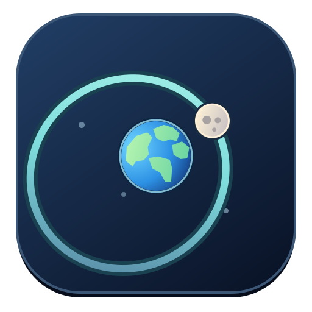

# Perigee



Perigee is a low-latency remote desktop and game-streaming client for Linux,
based on [Moonlight Qt](https://github.com/moonlight-stream/moonlight-qt).
Connect to Apollo or Sunshine for remote work or play.

## Download

[Perigee 6.2.0](https://github.com/BarMy49/perigee/releases/tag/v6.2.0-perigee.1) is available as an unsigned x86_64 prerelease.
Choose a package for your Linux setup.

| Package | Use it on |
| --- | --- |
| [Fedora 45 RPM](https://github.com/BarMy49/perigee/releases/download/v6.2.0-perigee.1/perigee-6.2.0-0.5.fc45.x86_64.rpm) | Fedora 45 with native Wayland support |
| [Fedora 44 RPM](https://github.com/BarMy49/perigee/releases/download/v6.2.0-perigee.1/perigee-6.2.0-0.5.fc44.x86_64.rpm) | Fedora 44 with its matching system libraries. Tested in a Fedora 44 container. |
| [Flatpak](https://github.com/BarMy49/perigee/releases/download/v6.2.0-perigee.1/Perigee-6.2.0-x86_64.flatpak) | Linux with Flatpak and the KDE Platform 6.11 runtime. Supports native Wayland. |
| [AppImage](https://github.com/BarMy49/perigee/releases/download/v6.2.0-perigee.1/Perigee-6.2.0-x86_64.AppImage) | Linux with X11 or XWayland. Make the file executable and run it directly. |

Install the matching RPM with `sudo dnf install ./PACKAGE.rpm` or the Flatpak
bundle with `flatpak install --user ./Perigee-6.2.0-x86_64.flatpak`.
The release includes matching source packages and
[SHA256SUMS](https://github.com/BarMy49/perigee/releases/download/v6.2.0-perigee.1/SHA256SUMS). If you downloaded only one package, compare
its `sha256sum PACKAGE` output with that package's line in the manifest.

The final Fedora 45 RPM and Flatpak passed live video, audio, keyboard/mouse and
reconnect checks on GNOME Wayland. The AppImage passed those checks with both
Apollo and Sunshine on XWayland.

### Windows

Windows 10 and 11 builds for x64 and ARM64 come from the
[Windows workflow](.github/workflows/release-windows.yml). It produces an unsigned
`PerigeeSetup-VERSION.exe` installer and `PerigeePortable-ARCH-VERSION.zip`
archives. Windows builds use their own settings
(`HKCU\Software\io.github.BarMy49\Perigee`) and never share pairing with an
installed Moonlight. The portable zip keeps everything in `perigee-data/` next
to `Perigee.exe`. Windows builds have passed CI but have not yet had live
streaming checks, and Moonlight import is Linux-only.

## Features

- **Desktop browsing and appearance.** Save favorites per host, navigate the host
  and app grids with the keyboard, and open tile menus with Shift+F10. Settings
  adapt to the window width and remember your light or dark theme.
- **Session profiles.** Edit Programming and Gaming profiles and choose one for
  a new session without changing global streaming settings.
- **In-stream controls.** Edit optional shortcuts in **Settings → Keyboard
  shortcuts**. Open the keyboard-only control panel with **Ctrl+Alt+Shift+O**
  for available actions such as fullscreen, capture, clipboard and statistics.
  **Ctrl+Alt+Shift+Z** always releases capture.
- **Text clipboard.** Opt in per host from the PC tile menu. With clipboard
  permission, **Ctrl+Alt+Shift+J** sends text and **Ctrl+Alt+Shift+K** receives
  it by default. GNOME native Wayland also supports focused automatic sync.
  Other desktops and XWayland use manual transfer.
- **Apollo launch options.** Request a virtual display for a new launch when
  the host grants permission and reports its driver ready. App launch by UUID
  is optional and requires authenticated host support. Open a configured HTTPS
  admin page from the host menu.
- **SFTP handoff.** Open a configured host destination in your desktop's SFTP
  handler.
- **Moonlight coexistence.** Perigee has separate settings, cache and pairing
  identity. Import Moonlight preferences explicitly, with pairing credentials
  included only if requested. Portable mode uses `perigee-portable.dat` and
  `perigee-data/`. See [identity and import](docs/BRANDING.md).
- **Streaming support.** Hardware decoding, available codecs, audio and gamepad
  support depend on the host, client GPU, drivers and package.

## Build and develop

Install the dependencies in the [Fedora build guide](docs/FEDORA_BUILD.md).
From the source checkout, initialize the pinned submodules and build out of tree.

```bash
git submodule update --init --recursive
source_root=$(pwd -P)
mkdir -p ../perigee-build/debug
cd ../perigee-build/debug
qmake6 "$source_root/moonlight-qt.pro"
make -j1 debug
./app/perigee
```

- On Windows, run `powershell ./setup-deps.ps1`, then
  `scripts\build-arch.bat Release x64` from a shell with Qt's MSVC `bin` on `PATH`
- [Focused Linux tests](tests/README.md)
- Package recipes for [RPM](packaging/rpm/README.md),
  [Flatpak](packaging/flatpak/README.md) and [AppImage](packaging/appimage/README.md)
- [Architecture](docs/ARCHITECTURE.md), [Apollo protocol](docs/APOLLO_PROTOCOL.md)
  and [upstream maintenance](docs/UPSTREAM_MAINTENANCE.md)

## License and attribution

Perigee derives from Moonlight Qt at `ac296864ace96f51ad75f78b90644bdbca76c332`.
See the [GPL license](LICENSE), [asset provenance](ASSET_NOTICES.md) for the
Earth and Moon icon, and [repository analysis](docs/REPOSITORY_ANALYSIS.md) for
dependency pins and source provenance.
