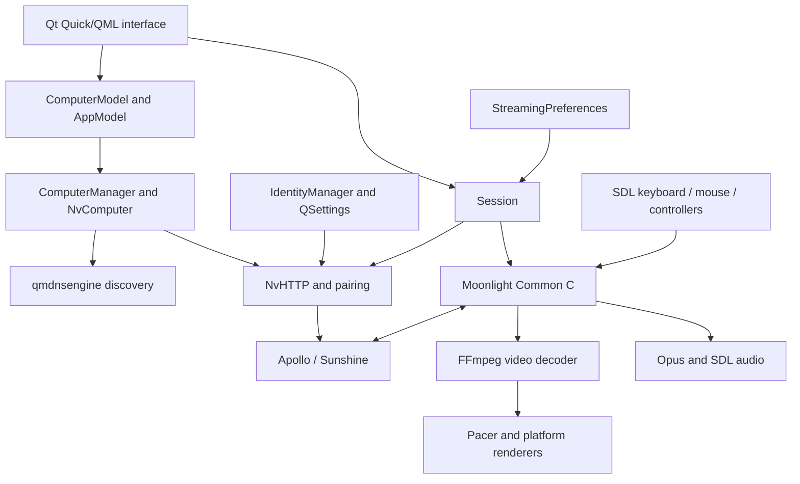
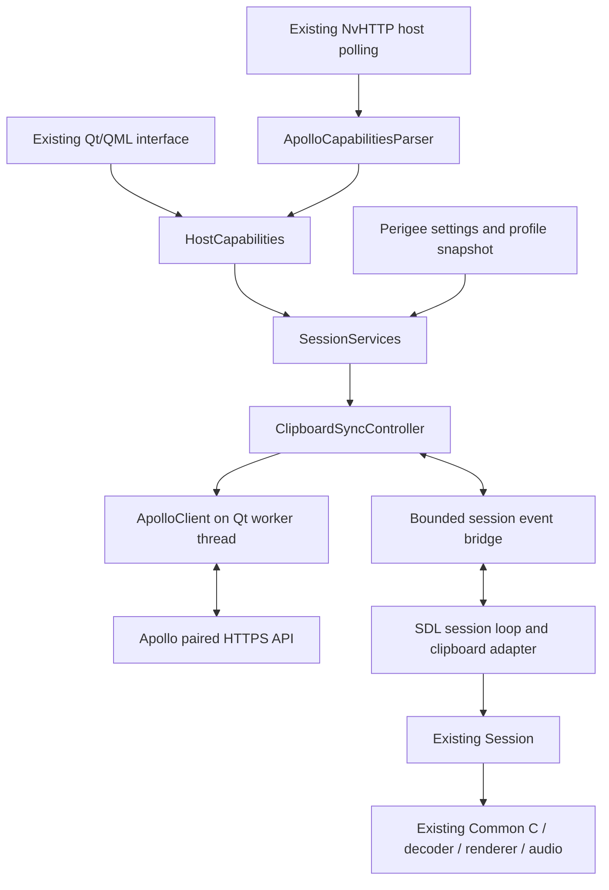

# Perigee architecture

Status: approved design; Tasks 1A/1B Linux native/portable and desktop identity
implemented, with explicit import/profile locking in Task 1C. Session-source
changes are cosmetic labels/icon only; no streaming threading,
decoding, rendering, input or networking lifecycle change.
Apollo integration components remain unimplemented. Source observations are frozen to the
2026-10-25 [repository manifest](REPOSITORY_ANALYSIS.md#inspected-revisions).
[Decisions](DECISIONS.md) record approval and alternatives. The application still
has upstream behavior; [milestone status](IMPLEMENTATION_PLAN.md#current-state)
is the source of truth for implementation progress.

## Existing Moonlight Qt architecture

### Components and dependencies

| Component | Existing responsibility and entry points |
| --- | --- |
| Startup | `app/main.cpp`, `main()`: application identity, logs/paths, Qt/SDL setup, command-line handling, QML type/singleton registration, and `IdentityManager::get()` |
| QML shell | `app/gui/main.qml`, `PcView.qml`, `AppView.qml`, `SettingsView.qml`, `StreamSegue.qml`; Qt Quick Controls/Material, layouts, navigation, launch/error views |
| Models | `ComputerModel`, `AppModel` expose C++ state to QML; keep network/protocol details out of views |
| Host management | `ComputerManager`, `PcMonitorThread`, `ComputerSeeker`, `NvComputer`, `NvAddress`, `NvApp`; discovery, polling, state, addresses, applications, persistence |
| Pairing/identity | `NvPairingManager` implements pairing; `IdentityManager` loads/generates TLS credentials and unique client ID |
| Host HTTP | `NvHTTP`: server information, apps/assets, launch/resume, cancellation, client TLS configuration, paired-server certificate handling |
| Preferences | `StreamingPreferences` loads/saves `QSettings` and exposes QML properties; `CompatFetcher` and `MappingFetcher` maintain upstream data |
| Session | `Session`: configuration, decoder probing, launch, connection callbacks, SDL window/input event loop, and deferred cleanup |
| Input | `SdlInputHandler` plus keyboard/mouse/touch/gamepad implementations translate SDL events into Common C calls |
| Transport | Pinned Moonlight Common C: RTSP/SDP, control/input, network audio/video reception, depacketization and recovery |
| Video | `FFmpegVideoDecoder`, `IFFmpegRenderer` implementations, and `Pacer`: decoder/renderer negotiation, hardware interop, presentation and pacing |
| Audio | Opus callbacks and audio renderers, including `SdlAudioRenderer` |
| Overlays | `Overlay::OverlayManager` and renderer hooks provide debug/status text surfaces; no existing general interactive toolbar |
| Platform | `app/wm.cpp`, `app/path.cpp`, `SystemProperties`, SDL and platform renderers; desktop environment, standard paths, display/input behavior |

Build: `moonlight-qt.pro` orchestrates the application and dependency qmake projects;
`app/app.pro` selects C++17 and Qt core/quick/network/quickcontrols2/svg. Linux uses
pkg-config for SDL, OpenSSL, Opus, FFmpeg, and optional platform/rendering libraries.
`globaldefs.pri` provides shared build flags. Preserve this arrangement.

The three top-level submodules are Common C, qmdnsengine, and SDL_GameControllerDB.
Common C also pins ENet and nanors. The current h264bitstream code is in-tree.
Exact pins and a source catalog are in [repository analysis](REPOSITORY_ANALYSIS.md).

### Discovery, pairing, and persistence

`ComputerManager::startPolling()` starts discovery for `_nvstream._tcp.local.` and
per-host polling. Manual host entry and `ComputerSeeker` resolve known or new hosts.
`NvComputer` stores addresses, identity, applications, a pinned server certificate,
and transient server/codec/display state. Its read/write lock protects shared state.

`NvPairingManager::pair()` exchanges GameStream pairing messages. `IdentityManager`
stores `certificate`, `key`, and `uniqueid`; `NvComputer` stores host `srvcert` and
UUID/address data. These must be considered together for pairing migration.
`ComputerManager` uses `hosts` and `hostsbackup` arrays when saving/recovering hosts.
The backup is part of the persistence behavior, not an independent host database.

Normal `NvHTTP` operations use the selected endpoint, true client UID for non-NVIDIA
hosts, and compatibility placeholder UID for NVIDIA hosts. Do not globally rewrite
UID construction or HTTP behavior to add Apollo features.

### Explicit import and profile ownership

Linux startup selects native/portable identity before opening settings consumers.
`import-moonlight` branches into a short-lived QCoreApplication before Qt GUI,
SDL subsystem setup, preferences, host discovery or identity initialization. It
uses `MoonlightImporter` to read an explicit bounded INI snapshot, validate an
allowlist/host set and optionally validate an existing RSA client tuple. It never
creates a normal identity as an import side effect or contacts a host.

`ProfileLock` lives on the normal startup stack until application teardown; the
importer holds the same settings-file sidecar lock throughout its transaction.
This prevents cooperating Perigee processes from racing first-run identity creation
with import, without introducing a worker or changing streaming synchronization.
`ProfilePublication` stages anonymous Linux files, validates serialized values,
and publishes by atomic no-overwrite hard link. No stream/decoder/input objects
are involved. Schema, filesystem requirements and interruption behavior are in
[the import contract](BRANDING.md#implemented-import-validation-and-storage).

### Session lifecycle and threading

1. The Qt UI selects a host/application and creates/configures `Session`.
2. Initialization and validation probe available formats/decoders and prepare input.
3. `Session::start()` acquires the active-session semaphore and runs connection
   establishment on `AsyncConnectionStartThread`.
4. `Session::startConnectionAsync()` performs host launch/resume and calls
   `LiStartConnection()` with video/audio/connection callbacks.
5. The worker's completion triggers `Session::exec()` on the GUI thread. Qt events
   are pumped once before the SDL window is created, then the SDL event loop runs.
6. Input, window events, and session commands are processed by SDL. Video decode,
   rendering/pacing, audio and transport have their existing callback/thread rules.
7. Teardown releases input/decoder/window resources and schedules
   `DeferredSessionCleanupTask`; it coordinates `LiStopConnection()` and allows the
   Qt shell to resume. The active-session semaphore prevents overlapping streams.

Crucial source: [Session startup and event loop](https://github.com/moonlight-stream/moonlight-qt/blob/ac296864ace96f51ad75f78b90644bdbca76c332/app/streaming/session.cpp#L1762).
The main Qt event loop is not normally serviced during the SDL loop. New timers,
queued GUI slots, or a QML clipboard singleton cannot be assumed to run in-stream.
Do not transplant Artemis's or Vibemis's different session threading architecture.

### Existing productivity and Linux behavior

- Input already supports absolute/direct desktop mouse behavior, relative capture,
  system-key capture modes, local escape/fullscreen/stats/mouse commands, and key
  release handling. Extend these mechanisms rather than duplicate them.
- `KeyComboPasteText` reads SDL clipboard text, normalizes CRLF for text injection,
  and calls `LiSendUtf8TextEvent()`. This types text; it does not synchronize the
  Windows clipboard. Physical key forwarding and IME/composed text are separate.
- Linux decoding/presentation paths include VA-API, VDPAU, EGL/DRM, and
  libplacebo/Vulkan. Vulkan presentation is distinct from Vulkan Video decoding.
  Selectable capabilities depend on build, driver, codec/profile, and GPU.
- Startup coordinates Qt and SDL Wayland/X11 backends. Mixed XWayland/native paths
  may alter hardware decoding. Keep upstream's basic Qt render-loop configuration.
- Qt's clipboard belongs to the Qt GUI connection. The SDL streaming window may
  own a different Wayland connection/focus; GUI-thread ownership alone does not
  make a hidden Qt window's clipboard access sufficient for streaming.
- PipeWire can underlie SDL audio or optional portals. GameStream reception does
  not require a Linux screen-capture pipeline.

## Approved Apollo integration design

### Boundary choice

Use small composed services and immutable capability/session values. Directly
adding all behavior to `NvHTTP`, `NvComputer`, and `Session` would concentrate
network policy, settings, and platform lifetime in upstream-heavy files. A generic
plugin/backend framework would add complexity without an established requirement.

The following names describe new planned types, not APIs already in the tree.

| Proposed component | Responsibility and ownership |
| --- | --- |
| `HostCapabilities` | Value snapshot of optional authenticated permissions, virtual-display state, application extensions, and ordered server commands |
| `ApolloCapabilitiesParser` | Pure parsing of known fields; preserves absent/invalid/denied distinctions; usable in fixture tests |
| `ApolloClient` | Asynchronous paired HTTPS client on one dedicated Qt worker thread; owns its QNetworkAccessManager and timers |
| `SessionServices` | Session-scoped integration owner, immutable startup data, cancellation, and optional-service state |
| `ClipboardSyncController` | Consent, direction/state, content revisions, bounded requests, echo suppression, failure policy |
| Platform clipboard adapter | Uses SDL clipboard APIs on the SDL/window owner thread while streaming; Qt clipboard APIs only during the normal Qt lifecycle |
| Session event bridge | Bounded message ownership and wakeup between SDL and the worker, with generation tags and deterministic cleanup |

### Data flow and contracts

- Parse capabilities during existing host metadata processing, under the existing
  synchronization discipline. Missing fields leave standard Sunshine unchanged.
- Only authenticated paired responses can establish permissions. Do not use the
  unauthenticated `Permission=0` response as an authorization result.
- Present Apollo-compatible capabilities rather than a guaranteed product/version
  claim. No verified `ApolloVersion` field exists in the inspected host.
- Configure a session from a value snapshot: host UUID, resolved endpoint/port,
  paired server certificate, client TLS configuration, consent, and capabilities.
  Workers must not dereference live mutable host/session objects.
- Create and use Qt network objects on their worker event-loop thread. Clipboard
  reads/writes and window actions execute on the SDL owner thread during streaming.
- Worker results enter a bounded session queue and wake SDL using a registered
  event type. Use owned messages, not unmanaged heap pointers in abandoned events.
  When SDL is no longer running, cancel/discard messages through normal teardown.
- Invalidate the session generation before cancellation/cleanup. Late replies from
  an old generation cannot write clipboard contents or invoke a replacement session.
- UI state reaches QML during its normal event processing. Active session actions
  cannot depend on queued GUI slots running while the SDL loop is in control.
- Preserve host certificate trust and client credentials; prohibit insecure
  fallback and redirects for sensitive traffic. Detailed policy is in
  [Apollo protocol](APOLLO_PROTOCOL.md#text-clipboard-contract).

SDL clipboard retrieval can block. Automatic clipboard reads require a measured
platform-adapter gate; use manual actions on a backend where focus restrictions or
stalls prevent safe automation. A worker does not remove compositor restrictions.

### UI, profiles, and controls

Keep the main Qt/QML shell and Qt Quick Controls. Incrementally add desktop
favorites, clear host/application navigation, light/dark themes, keyboard access,
responsive spacing, and settings organization. Keep native decorations. Do not add
Kirigami, libadwaita, or another large UI framework solely for visual refresh.

Initial in-stream controls are a keyboard-accessible command panel using existing
overlay rendering hooks and session actions. Re-render small overlay surfaces only
when state changes; do not read back video frames or introduce a continuously
rendered QML scene. Mouse interaction is a separate tested increment. Unsupported
live display changes stay unavailable rather than being simulated by an unsafe
disconnect/relaunch. Reconnect means a new controlled session lifecycle, not a
claim that the host display mode changed.

Profiles will snapshot existing preferences without mutating active global state.
The Programming starter preset uses SDR, 60 FPS, automatic codec selection and the
upstream bitrate calculation. Gaming starts from upstream behavior. User overrides
remain available. Do not enable 4:4:4 if it silently requires software decoding.

## Streaming preservation and deferred interfaces

- No changes to packet recovery/jitter handling, decoder probing, hardware interop,
  audio buffering, input ordering, or pacing for initial Apollo services.
- H.264/HEVC/AV1, HDR and 4:4:4 already exist upstream; preserve them. Colored text
  may benefit from full chroma detail, but quantify it on real hardware. Codec-name
  support does not imply all chroma/depth profiles are hardware accelerated.
- Keep one active streaming session per process. Multiple host monitors, simultaneous
  displays, and live topology changes need host evidence beyond stream dimensions.
- Keep fractional host refresh experimental until nominal client FPS, decoder,
  pacing, and actual host mode agree in measurements.
- Native image clipboard/file transfer are not implemented host capabilities in
  this snapshot. Optional SFTP opens a user-managed destination through desktop
  integration; it must not provision a host service.
- Apollo commands are the documented exception: a separately reviewed additive
  Common C control function is required. Keep them disabled until that patch and
  a reproducible distributable dependency revision exist; do not replace the core
  wholesale or invent an HTTP command endpoint.

## Implemented capability foundation

Milestone 2 composes `ApolloCapabilities` with the existing `NvHTTP` serverinfo
and `NvComputer` polling/update path. Reply provenance is captured from the
successful same-origin pinned HTTPS response; the pure parser adds paired-status
and field validation. No extension probe, worker, timer or nested event loop was
added. Each update replaces the ephemeral value; offline transition invalidates
authentication. Persisted state gains only the explicit validated administration
URL, which is not overwritten by network updates or copied by the import allowlist.

`ComputerModel` provides read-only value/detail roles to `PcView.qml` and a UUID
addressed setter for the separate admin link. The capabilities panel displays a
plain-text snapshot; browser launch is explicit. No stream/session behavior or
permission mutation is introduced. This is the metadata part of ADR-002, not an
implementation of the planned asynchronous session services. Test and acceptance
limits are recorded in [Milestone 2](IMPLEMENTATION_PLAN.md#milestone-2-apollo-foundation).

## Implemented Task 3A bridge

`streaming/services/SessionServices` consumes a const `SessionServiceSnapshot`:
host UUID, resolved HTTPS endpoint, paired pin, client TLS configuration,
capabilities and an explicit enable flag. Owner methods run on the creating SDL/GUI
thread. `SessionServiceWorker` creates Qt networking/timers on its own QThread,
performs only explicitly submitted bounded GETs, and has no mutable host/session
or GUI pointers. One outstanding request also bounds queued worker invocations.
No worker completion depends on the suspended Qt GUI event loop.

`SessionEventBridge` owns payloads separately from SDL events. It bounds count,
individual and total bytes, tags messages with a process-unique session generation,
and coalesces pointer-free wakeups. Registered events avoid upstream's fixed
`SDL_USEREVENT`. The application supports one active session; stop invalidates and
clears the queue/wakeup before worker cancellation/join, so late results cannot
act on a replacement session. Reply abort/deletion, timers and manager destruction
stay on the worker. Stop does not invoke or wait for GUI slots.

`Session::start()` captures immutable values under the host read lock before
connection work. `exec()` starts services only after window setup and provides a
small SDL dispatch hook; failure/exit paths release services before SDL video or
Common C cleanup. At Task 3A delivery services remained disabled, with no worker or wakeup
allocation and no service traffic. Task 3B now conditionally enables the manual
clipboard path described below. No clipboard/window action is attached to the dispatcher yet.
Transport operation policy and owner-thread clipboard adapters remain Task 3B;
there is no change to the approved media loop or renderer ownership.

See [Task 3A evidence](IMPLEMENTATION_PLAN.md#task-3a-implementation-and-local-evidence-2026-10-25)
for fixture coverage and pending real-stream/performance checks. This implements
the bridge part of ADR-003, not compositor clipboard acceptance.

## Implemented session text clipboard

Task 3B composes `ClipboardSync` and `SdlClipboard` with the existing service
owner. Host consent and authenticated direction/view permissions are snapshotted
before connection work. A worker is started only after successful stream/window
setup, and only for eligible opted-in hosts. SDL shortcuts initiate manual send or
receive; owner-thread validation/revision checks precede local application. No
clipboard work occurs in the Qt GUI event loop or on a worker/window cross-thread
call. Controller ownership is released before service cancellation and video
teardown. Input changes add only consent-gated local shortcuts; the existing
text-injection paste and media algorithms are preserved.

Each operation has one request ID/generation. HTTP status and payload are distinct;
bounded raw UTF-8 reaches the owner through the bridge. Queue bounds are now
1 MiB per payload and 4 MiB aggregate. Pending writes coalesce; stale/focus-lost
reads cannot replace newer local text. No content/hash is persisted or logged.

After user-verified GNOME manual acceptance, automatic synchronization is wired
for native Wayland with an exact GNOME desktop token. Other platforms retain
manual actions. A worker-owned one-second timer publishes coalesced, generation-
tagged ticks through the existing bounded bridge; it never calls a clipboard API.
The SDL owner reads focused local text, establishes baselines, dispatches bounded
requests and applies eligible remote changes. No GUI Qt timer or nested event
loop is introduced. Focus loss invalidates reads, drops queued writes and pauses
dispatch; focus regain resumes observation. Direction grants are checked before
queueing writes, so a receive-only host cannot starve polling behind a forbidden
upload. Denial stops automatic ticks until a new session.

All SDL reads in automatic mode, including reply-time revision checks, use a
4 ms API-read budget. This is a conservative engineering cutoff for fallback,
not a measured worst-case guarantee. A slow call has already blocked once; it
cannot be interrupted safely on another thread. Missing/invalid text or a read
over budget disables automatic mode for this session, clears queued writes and
shows a manual-fallback notice. Manual J/K remains available. Only the first
automatic read duration and fallback diagnostics are logged, without content.
The controller's clock enforces poll/backoff deadlines; worker ticks supply the
previously missing owner wakeup. The integrated GNOME automatic path is accepted
by the user; secondary-platform and controlled latency coverage remain follow-ups.
See [Task 3B](IMPLEMENTATION_PLAN.md#milestone-0-and-task-3b-closure-2026-10-25).

## Clipboard result notifications

The 3B feedback follow-up layers a timed notice onto the existing status slot.
Primary connection/gamepad status remains authoritative; a notice cannot clear it.
The notice uses a separate cached small font and fixed text storage, with updates
only when rendered content changes. Expiry is checked in the SDL owner loop and
bounds its idle wait. No new overlay type or DRM plane is required, and no renderer
or media-loop architecture is replaced. Controller outcomes reach the display only
on the owner thread, after host acknowledgement/local application respectively.
See [verification](IMPLEMENTATION_PLAN.md#clipboard-confirmation-follow-up-2026-10-25).

## Validation and navigation

Use [development rules](DEVELOPMENT_RULES.md) for changes and review,
[Fedora build](FEDORA_BUILD.md) for actual test commands and platform caveats,
[branding](BRANDING.md) for identity/authentication separation, and
[implementation plan](IMPLEMENTATION_PLAN.md#verification-strategy) for acceptance.
No compile, runtime, or performance result is implied by these diagrams.
